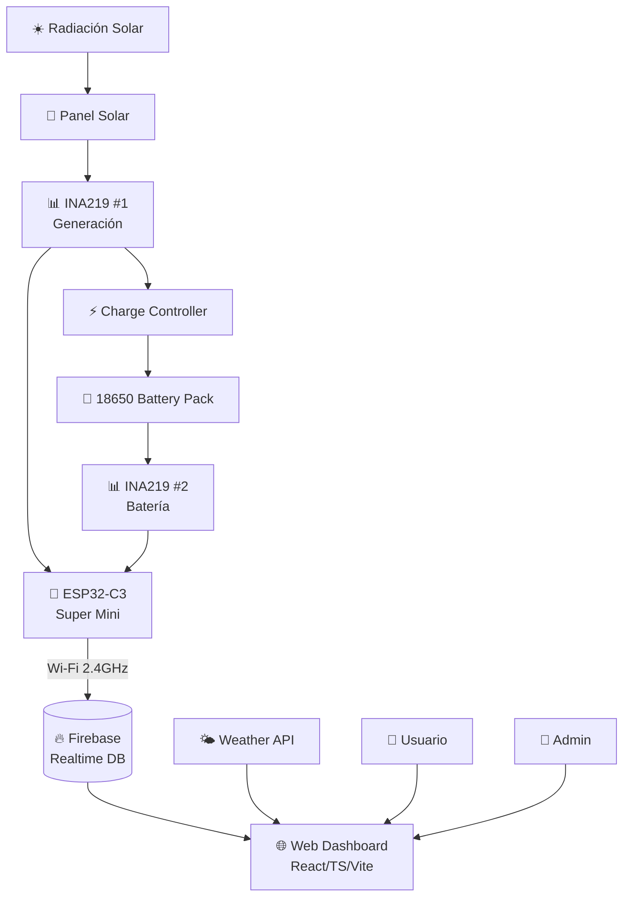
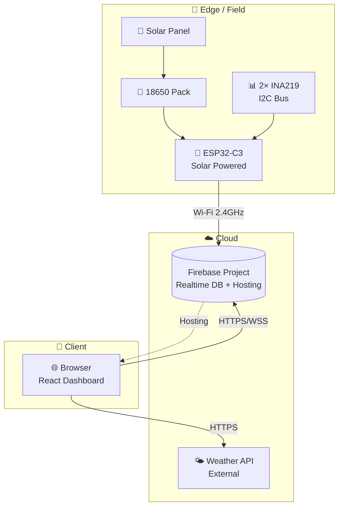
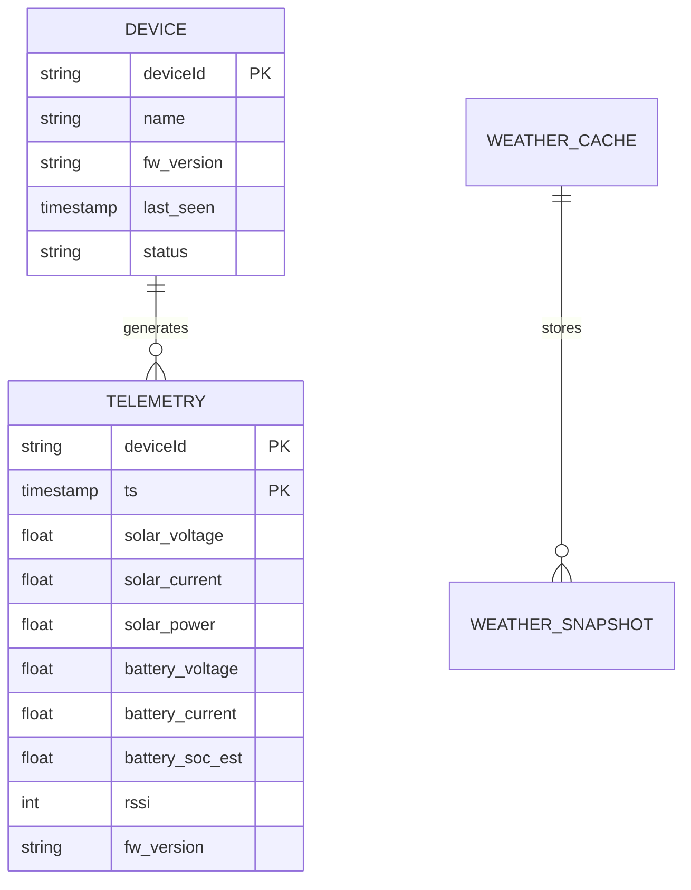
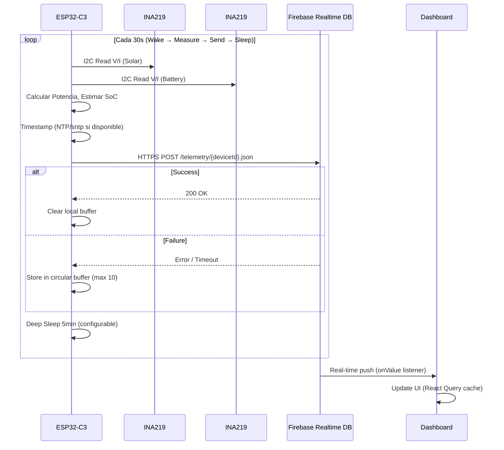
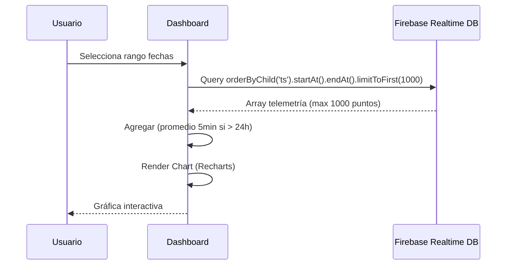
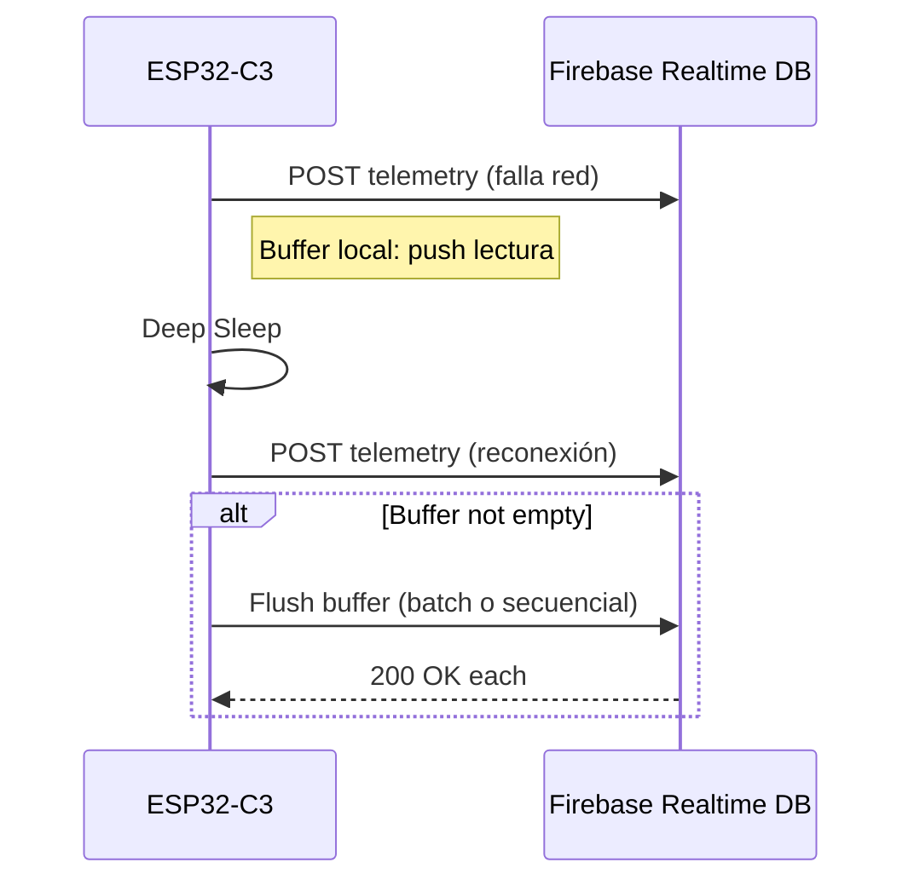

# Architecture / Arquitectura del Sistema

**Estado:** Propuesta inicial v1.0 — Solar Monitoring

---

## Propósito del documento

Describe la **estructura técnica de alto nivel**: componentes, responsabilidades, comunicación, datos, infraestructura y decisiones transversales. Es la "vista 10,000 pies" para desarrolladores, ops y stakeholders técnicos.

---

## 1. Visión general / System Context

### 1.1 Diagrama de contexto (C4 Level 1)


### 1.2 Descripción narrativa
Solar Monitoring es un sistema IoT de tres capas que monitorea una instalación solar fotovoltaica pequeña. La **capa embebida** (ESP32-C3 + 2× INA219) adquiere métricas de generación solar y estado de batería 18650, transmitiéndolas cada 30s vía Wi-Fi 2.4GHz a **Firebase Realtime Database**. La **capa de presentación** (React 18 + TypeScript + Vite) consume datos en tiempo real vía listeners Firebase y presenta un dashboard responsive con diseño **Fluent Design System** (estilo Microsoft 365), usando **grid 12-columnas: Desktop 12, Tablet 8, Mobile 4**. El sistema opera primariamente con energía solar, usando deep sleep para eficiencia energética.

---

## 2. Vistas arquitectónicas (basado en C4)

### 2.1 Vista Lógica / Contenedores (C4 Level 2)
| Contenedor | Tecnología | Responsabilidad | Comunicación |
|------------|------------|-----------------|--------------|
| **Web Dashboard** | React 18 + TypeScript + Vite | UI responsive, state management (React Query), charts (Recharts), Fluent Design tokens | HTTPS → Firebase Realtime DB (WebSocket), REST → Weather API |
| **Firebase Realtime DB** | Firebase (plan Spark) | Persistencia telemetría, sync tiempo real, reglas seguridad | WebSocket (clients), REST (device), Auth (anónimo MVP) |
| **ESP32 Firmware** | ESP-IDF / Arduino Core (C++) | Adquisición sensores I2C, Wi-Fi, deep sleep, buffer local, envío HTTPS | I2C (sensores), Wi-Fi 2.4GHz → Firebase REST API |
| **INA219 #1 (Solar)** | HW Sensor I2C addr 0x40 | Medir voltaje, corriente panel → calcular potencia | I2C 100kHz |
| **INA219 #2 (Batería)** | HW Sensor I2C addr 0x41 | Medir voltaje, corriente carga/descarga batería | I2C 100kHz |
| **Weather API** | OpenWeatherMap / WeatherAPI | Datos meteorológicos para correlación | HTTPS REST (cache 10min) |

### 2.2 Vista de Despliegue / Infraestructura


| Componente | Proveedor / Config | Notas |
|------------|---------------------|-------|
| **Firebase** | Plan Spark (gratuito) | Realtime DB: 1GB storage, 10GB/month download. Hosting: 10GB, 360MB/day. Auth: Anonymous (MVP). |
| **Dashboard Hosting** | Firebase Hosting / Vercel | CI/CD via GitHub Actions. Preview deployments en PRs. |
| **Weather API** | OpenWeatherMap One Call 3.0 (gratuito 1000 calls/día) | Cache 10min en frontend (React Query). Fallback graceful. |
| **CI/CD** | GitHub Actions | Lint → Typecheck → Test → Build → Deploy Preview/Prod |
| **Firmware Build** | ESP-IDF Docker / GitHub Actions | Artifacts: `.bin` firmado, checksums SHA256 |

---

## 3. Patrones y decisiones transversales (referencia a ADRs)

| Área | Patrón / Decisión | ADR |
|------|-------------------|-----|
| **Arquitectura General** | **Modular por capas** (App / Services / Drivers / HAL / RTOS en firmware; Feature-based en frontend) | ADR-001 |
| **Comunicación Device→Cloud** | **HTTPS REST a Firebase** (simplicidad MVP, sin broker MQTT propio) | ADR-002 |
| **Sincronización Tiempo Real** | **Firebase Realtime Listeners** (WebSocket nativo, offline support) | ADR-003 |
| **Gestión Energía Embebida** | **Deep Sleep duty-cycling** (30s activo / 5min sleep) + buffer local | ADR-004 |
| **Diseño UI** | **Fluent Design System tokens** (color, spacing, typography, motion, elevation) | ADR-005 |
| **Grid Responsive** | **12-column grid**: Desktop 12, Tablet 8, Mobile 4 (breakpoints 1024/768) | ADR-006 |
| **Estructura Datos Firebase** | **Plana por deviceId + timestamp** (optimizada para queries por rango) | ADR-007 |
| **Seguridad MVP** | **Auth anónimo + reglas write-restringidas** (deviceId como uid) | ADR-008 |
| **Testing Strategy** | **Testing Trophy**: Unit (Vitest) → Integration (Testcontainers Firebase Emulator) → E2E (Playwright) | ADR-009 |
| **Monorepo Structure** | **Turborepo**: apps/web, apps/firmware, packages/ui, packages/design-tokens | ADR-010 |

---

## 4. Modelo de datos de alto nivel

> Detalle en [Data Model](04-data-model.md).



---

## 5. Flujos críticos (Sequence Diagrams)

### 5.1 Ciclo de adquisición y envío (cada 30s)


### 5.2 Consulta histórica (Dashboard)


### 5.3 Recuperación tras desconexión


---

## 6. Modularidad (Arquitectura Modular)

### 6.1 Firmware (ESP32) — Capas desacopladas
```
apps/firmware/
├── src/
│   ├── app/                 # Application layer: main loop, state machine
│   │   ├── acquisition/     # Orquesta lectura sensores + cálculos
│   │   ├── communication/   # Wi-Fi, Firebase client, buffer, retry
│   │   ├── power/           # Deep sleep, wake reasons, battery monitor
│   │   └── diagnostics/     # Logs, health checks, self-test
│   ├── services/            # Business logic services (reutilizables)
│   │   ├── telemetry/       # Formato payload, validación, serialización
│   │   ├── time/            # NTP/sntp, timestamp, timezone
│   │   └── config/          # NVS: Wi-Fi creds, intervals, thresholds
│   ├── drivers/             # Hardware abstraction (portable)
│   │   ├── ina219/          # Driver INA219: init, read, calibrate
│   │   ├── i2c/             # Bus I2C shared, mutex, scan
│   │   └── gpio/            # LED, buttons
│   ├── hal/                 # Hardware Abstraction Layer (ESP-IDF specific)
│   │   ├── esp_wifi/        # Wi-Fi init, connect, disconnect, events
│   │   ├── esp_sleep/       # Deep/light sleep, wake sources
│   │   └── esp_nvs/         # Non-volatile storage encrypted
│   └── rtos/                # FreeRTOS: tasks, queues, semaphores, timers
├── test/                    # Unit (Unity) + Integration (target)
└── CMakeLists.txt
```
**Principio:** Cada capa solo conoce la inferior. Tests mockean `drivers/` y `hal/`.

### 6.2 Frontend (React) — Feature-based
```
apps/web/
├── src/
│   ├── app/                    # App shell: providers, routing, layout
│   ├── features/               # Dominios de negocio (cada uno independiente)
│   │   ├── dashboard/          # Overview, cards, live indicators
│   │   │   ├── components/     # DashboardGrid, MetricCard, LiveBadge
│   │   │   ├── hooks/          # useTelemetryRealtime, useDeviceStatus
│   │   │   └── api/            # Firebase listeners, queries
│   │   ├── historical/         # Gráficas, filtros, export
│   │   │   ├── components/     # ChartContainer, DateRangePicker, ExportButton
│   │   │   ├── hooks/          # useHistoricalData, useAggregation
│   │   │   └── api/            # Firebase range queries
│   │   ├── device-status/      # RSSI, firmware, health, diagnostics
│   │   ├── weather/            # Weather widget, cache, fallback
│   │   └── settings/           # Admin config (v2)
│   ├── shared/                 # Código compartido entre features
│   │   ├── ui/                 # Design System components (Fluent tokens)
│   │   ├── hooks/              # useDebounce, useLocalStorage, etc.
│   │   ├── utils/              # formatters, validators, constants
│   │   └── types/              # Tipos TypeScript generados (OpenAPI/Zod)
│   └── styles/                 # Global CSS, Fluent tokens (CSS vars), reset
├── package.json
└── vite.config.ts
```
**Principio:** Features no se importan entre sí. Comparten solo `shared/`. Lazy loading por ruta.

### 6.3 Paquetes compartidos (Monorepo Turborepo)
```
packages/
├── design-tokens/        # Fluent Design tokens → CSS vars, TS, JSON (Style Dictionary)
├── ui/                   # Component library (Storybook, tests, a11y)
├── eslint-config/        # Shared ESLint config
├── tsconfig/             # Shared TypeScript configs (base, react, node)
└── firebase-types/       # Tipos generados desde reglas Firebase / Data Model
```

---

## 7. Seguridad (Security Architecture)

| Capa | Medidas |
|------|---------|
| **Transporte** | TLS 1.3 everywhere (Firebase + Weather API + Hosting) |
| **Device Auth** | Firebase Anonymous Auth + custom token con `deviceId` claim (MVP) |
| **Firestore Rules** | `match /telemetry/{deviceId}/{ts} { allow read: if true; allow write: if request.auth.uid == deviceId; }` |
| **Secrets Device** | NVS encriptado (ESP-IDF `nvs_encryption`), credenciales Wi-Fi + Firebase config |
| **Secrets Frontend** | Firebase config público (API key) — no secrets en repo. Variables de entorno para Weather API key. |
| **CSP / Headers** | `Content-Security-Policy` estricta, `X-Frame-Options: DENY`, `Referrer-Policy: strict-origin` |
| **Dependencias** | `pnpm audit` + Dependabot + `npm audit` en CI |

---

## 8. Observabilidad (Observability)

### 8.1 Métricas clave (Four Golden Signals)
| Señal | Métrica | Target | Alerta |
|-------|---------|--------|--------|
| Latency | `telemetry_latency_ms` (sensor→Firebase) | p95 `< 30000` | `> 60000` |
| Traffic | `telemetry_received_total` | 2880/día (30s interval) | Drop > 50% |
| Errors | `firebase_write_errors_total` | `< 1%` | `> 5%` |
| Saturation | `esp_free_heap_bytes` | `> 50KB` | `< 20KB` |

### 8.2 Instrumentación
- **Firmware:** Structured logs (JSON) via UART (dev) / buffer circular (prod) → flush on reconnect. Niveles: ERROR, WARN, INFO, DEBUG.
- **Frontend:** React Query devtools, `console.debug` con prefijos `[feature]`, Sentry (opcional) para error tracking.
- **Firebase:** Built-in metrics (conexiones, ancho de banda, almacenamiento) en Console.

### 8.3 Dashboards y Alertas
- **Grafana Cloud Free** / **Firebase Console** para métricas.
- **Alertas:** GitHub Actions workflow programado (cada 15min) consulta Firebase REST → alerta Telegram/Email si device offline > 10min.

---

## 9. Disaster Recovery / Business Continuity

| Métrica | Target | Estrategia |
|---------|--------|------------|
| RPO | `< 5 min` | Firebase: replicación automática multi-zona (managed) |
| RTO | `< 1 hora` | Dashboard: redeploy automático desde `main` (GitHub Actions + Firebase Hosting) |
| Backup Firmware | Cada release | Artifacts en GitHub Releases (binarios firmados + SHA256) |
| Rollback Dashboard | `< 5 min` | `git revert` + push → auto-deploy preview → promote |

---

## 10. Costes y Capacity Planning (estimación MVP)

| Recurso | Config | Coste estimado/mes | Notas |
|---------|--------|-------------------|-------|
| Firebase Spark | 1GB DB, 10GB DL, 10GB Hosting | $0 | Gratuito, límites suficientes MVP |
| Weather API | OpenWeatherMap Free | $0 | 1000 calls/día (cache 10min = 144/día) |
| GitHub Actions | 2000 min/mes gratis | $0 | Suficiente para CI/CD |
| Vercel / Netlify (alt) | Hobby | $0 | Alternativa hosting |
| **Total MVP** | | **$0** | Cero coste operativo |

---

## 11. Glosario técnico del proyecto

| Término | Definición |
|---------|------------|
| **Duty Cycling** | Ciclo activo/sleep para ahorro energía (30s on / 5min off) |
| **Buffer Circular** | Almacén temporal en RAM/Flash para lecturas sin conexión |
| **Fluent Design** | Sistema de diseño Microsoft: luz, profundidad, movimiento, material, escala |
| **Grid 12-col** | Sistema rejilla: Desktop 12, Tablet 8, Mobile 4 columnas |
| **SoC Estimation** | Estimación State of Charge: OCV + Coulomb Counting híbrido |

---

## Historial de versiones

| Versión | Fecha | Autor | Cambios |
|---------|-------|-------|---------|
| 0.1 | 2024-11-20 | Matías Biem | Plantilla base |
| 1.0 | 2024-11-20 | Matías Biem | Arquitectura Solar Monitoring v1.0 con modularidad, Fluent Design, grid 12-col |