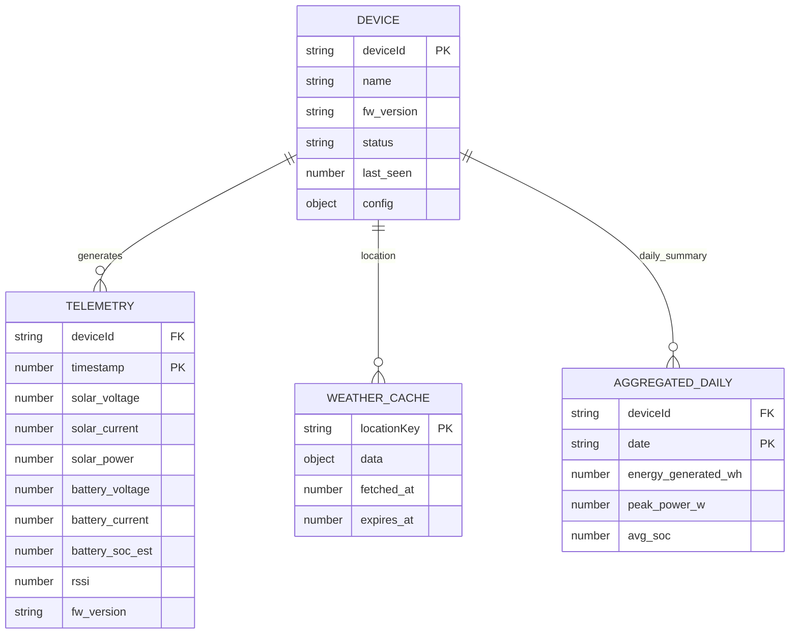

# Data Model / Modelo de Datos

**Estado:** v1.0 — Solar Monitoring MVP

---

## Propósito del documento

Define la **estructura de datos persistente**: entidades, atributos, relaciones, restricciones, índices y estrategias de migración. Sirve como contrato entre firmware, backend (Firebase), frontend (types), y base de datos.

---

## 1. Principios de modelado

- **Naming Firebase:** `snake_case` para keys, `camelCase` en código TypeScript
- **IDs:** `deviceId` (string, formato: `solar-mon-{MAC_suffix}`) + `timestamp` (epoch ms UTC) como clave compuesta
- **Timestamps:** Siempre epoch milliseconds UTC (`Number` en Firebase, `number` en TS). Frontend convierte a zona local.
- **Soft delete:** No aplica (append-only telemetría). Retención por TTL / Cloud Function.
- **Versionado:** `fw_version` en cada registro de telemetría para correlación.
- **Multi-tenancy:** MVP single-tenant (un dispositivo). Diseño preparado para multi-device vía `deviceId` namespace.

---

## 2. Convenciones de tipos

| Concepto | Firebase (JSON) | TypeScript | Notas |
|----------|-----------------|------------|-------|
| Device ID | `string` | `string` | `solar-mon-{XXYYZZ}` |
| Timestamp | `number` (epoch ms) | `number` | UTC, generado en device (NTP) o server |
| Voltaje | `number` | `number` | Voltios, 2 decimales (ej: 12.34) |
| Corriente | `number` | `number` | Amperios, 3 decimales (ej: 1.234), signo = dirección |
| Potencia | `number` | `number` | Vatios, 2 decimales (V × I) |
| SoC Estimado | `number` | `number` | Porcentaje 0-100, 1 decimal (ej: 87.5) |
| RSSI | `number` | `number` | dBm, entero negativo (ej: -67) |
| Versión FW | `string` | `string` | SemVer: `v1.2.3` |

---

## 3. Entidades core

### Entidad: `Device` (Dispositivo)
**Path:** `/devices/{deviceId}`

| Campo | Tipo | Requerido | Descripción |
|-------|------|-----------|-------------|
| `deviceId` | `string` | PK | `solar-mon-{MAC_suffix}` |
| `name` | `string` | Sí | Nombre amigable: "Solar Monitor Principal" |
| `location` | `string` | Opcional | "Tejado Casa", "Campo Experimental" |
| `fw_version` | `string` | Sí | Versión firmware actual |
| `hw_version` | `string` | Opcional | "ESP32-C3-SuperMini-v1.0" |
| `status` | `string` | Sí | `online` \| `offline` \| `degraded` \| `maintenance` |
| `last_seen` | `number` | Sí | Epoch ms última telemetría recibida |
| `battery_health` | `string` | Opcional | `good` \| `fair` \| `poor` \| `critical` |
| `config` | `object` | Sí | Configuración dispositivo (ver abajo) |
| `created_at` | `number` | Sí | Epoch ms registro inicial |
| `updated_at` | `number` | Sí | Epoch ms última actualización config |

#### `config` (sub-objeto)
```json
{
  "measurement_interval_sec": 30,
  "deep_sleep_duration_sec": 300,
  "solar_sensor_addr": "0x40",
  "battery_sensor_addr": "0x41",
  "soc_estimation_method": "hybrid_ocv_coulomb",
  "soc_calibration": {
    "voltage_full": 4.2,
    "voltage_empty": 3.0,
    "capacity_mah": 2600
  },
  "thresholds": {
    "battery_voltage_low": 3.2,
    "battery_voltage_critical": 3.0,
    "solar_power_min": 0.5,
    "rssi_warning": -80
  },
  "wifi": {
    "ssid": "***",
    "reconnect_max_attempts": 5,
    "reconnect_backoff_base_sec": 60
  }
}
```

---

### Entidad: `Telemetry` (Medición)
**Path:** `/telemetry/{deviceId}/{timestamp}`

**Clave compuesta:** `deviceId` + `timestamp` (epoch ms). Firebase usa push IDs o timestamp como key.

| Campo | Tipo | Requerido | Descripción |
|-------|------|-----------|-------------|
| `deviceId` | `string` | Sí | FK → `/devices/{deviceId}` |
| `timestamp` | `number` | Sí | Epoch ms UTC (generado en device) |
| `solar_voltage` | `number` | Sí | Voltios panel (V) |
| `solar_current` | `number` | Sí | Amperios panel (A), + = generación |
| `solar_power` | `number` | Sí | Vatios (W) = V × I |
| `battery_voltage` | `number` | Sí | Voltios batería (V) |
| `battery_current` | `number` | Sí | Amperios batería (A), + = carga, - = descarga |
| `battery_soc_est` | `number` | Sí | SoC estimado % (0-100, 1 decimal) |
| `rssi` | `number` | Sí | Señal Wi-Fi (dBm) |
| `fw_version` | `string` | Sí | Versión firmware que generó el dato |
| `uptime_sec` | `number` | Opcional | Segundos desde boot (para diagnóstico) |
| `free_heap_bytes` | `number` | Opcional | Memoria libre ESP32 (diagnóstico) |
| `wake_reason` | `string` | Opcional | `timer` \| `external` \| `touch` \| `ulp` |

**Reglas de validación (aplicadas en firmware y/o Firebase Rules):**
- `solar_voltage`: 0–25V (panel típico 18-22V Voc)
- `solar_current`: -5A a +5A (según shunt INA219)
- `solar_power`: ≥ 0 (redondeado 2 decimales)
- `battery_voltage`: 2.5V–4.5V (por celda 18650)
- `battery_current`: -3A a +3A (carga max 1A, descarga max 2A)
- `battery_soc_est`: 0–100
- `rssi`: -120 a -30 dBm
- `timestamp`: monotónico creciente por deviceId

---

### Entidad: `WeatherCache` (Cache Meteorológico)
**Path:** `/weather_cache/{locationKey}`

| Campo | Tipo | Requerido | Descripción |
|-------|------|-----------|-------------|
| `locationKey` | `string` | PK | `lat,lon` redondeado 2 decimales (ej: "-34.60,-58.38") |
| `data` | `object` | Sí | Respuesta completa API (OpenWeatherMap One Call) |
| `fetched_at` | `number` | Sí | Epoch ms cuando se obtuvo |
| `expires_at` | `number` | Sí | `fetched_at + 600000` (10 min TTL) |

**Estructura `data` (subconjunto relevante):**
```json
{
  "current": {
    "temp": 22.5,
    "humidity": 65,
    "clouds": 20,
    "uvi": 5.2,
    "wind_speed": 3.1,
    "weather": [{ "main": "Clear", "description": "clear sky", "icon": "01d" }]
  },
  "hourly": [
    { "dt": 1700000000, "temp": 21.8, "clouds": 15, "uvi": 4.8 }
  ],
  "daily": [
    { "dt": 1700000000, "temp": { "min": 15.2, "max": 26.8 }, "clouds": 10, "uvi": 6.1 }
  ]
}
```

---

### Entidad: `AggregatedDaily` (Pre-agregado diario — opcional, Cloud Function)
**Path:** `/aggregated/daily/{deviceId}/{date_YYYYMMDD}`

| Campo | Tipo | Descripción |
|-------|------|-------------|
| `deviceId` | `string` | FK |
| `date` | `string` | YYYY-MM-DD |
| `energy_generated_wh` | `number` | Energía solar diaria (Wh) = Σ(power × intervalo) |
| `energy_consumed_wh` | `number` | Energía consumida de batería (Wh) |
| `peak_power_w` | `number` | Potencia pico instantánea |
| `avg_soc` | `number` | SoC promedio día |
| `min_soc` | `number` | SoC mínimo |
| `max_soc` | `number` | SoC máximo |
| `total_measurements` | `number` | Count lecturas válidas |
| `uptime_percent` | `number` | % tiempo online (basado en gap < 2×intervalo) |

> **Nota:** Generado por Cloud Function programada (diaria 00:05 UTC) para acelerar consultas históricas en dashboard.

---

## 4. Índices y Consultas (Firebase Realtime Database)

Firebase Realtime Database no tiene índices secundarios tradicionales; se usa **ordenación por clave** y **estructura de datos optimizada para queries**.

### Estructura optimizada:
```
/telemetry
  /{deviceId}
    /{timestamp}          <- Key = timestamp (epoch ms), permite orderByKey()
    /latest               <- Último registro (actualizado en cada write)
    /daily_index          <- Opcional: { "20241120": true, "20241121": true } para listar días
```

### Queries principales:

| Caso de uso | Query Firebase | Límites |
|-------------|----------------|---------|
| **Tiempo real (último)** | `ref.child('telemetry').child(deviceId).child('latest').onValue()` | 1 listener |
| **Histórico rango fechas** | `ref.child('telemetry').child(deviceId).orderByKey().startAt(startMs).endAt(endMs).limitToFirst(1000)` | 1000 pts |
| **Últimas N lecturas** | `ref.child('telemetry').child(deviceId).orderByKey().limitToLast(100)` | 100 pts |
| **Dispositivos online** | `ref.child('devices').orderByChild('status').equalTo('online')` | Requiere indexOn: "status" |

### Reglas de índice (`.indexOn` en rules):
```json
{
  "rules": {
    "devices": {
      ".indexOn": ["status", "last_seen"]
    },
    "telemetry": {
      "$deviceId": {
        ".indexOn": [".key"]  // timestamp es la key
      }
    }
  }
}
```

---

## 5. Reglas de Seguridad (Firebase Rules) — MVP

```json
{
  "rules": {
    // Telemetría: lectura pública, escritura solo device autenticado
    "telemetry": {
      "$deviceId": {
        ".read": true,
        ".write": "auth != null && auth.uid == $deviceId",
        "$timestamp": {
          ".validate": "newData.hasChildren(['deviceId', 'timestamp', 'solar_voltage', 'solar_current', 'solar_power', 'battery_voltage', 'battery_current', 'battery_soc_est', 'rssi', 'fw_version'])"
        }
      }
    },
    
    // Dispositivos: lectura pública, escritura solo owner (admin)
    "devices": {
      ".read": true,
      "$deviceId": {
        ".write": "auth != null && (auth.uid == $deviceId || auth.token.admin == true)",
        ".validate": "newData.hasChildren(['deviceId', 'name', 'fw_version', 'status', 'last_seen', 'config'])"
      }
    },
    
    // Weather cache: lectura pública, escritura solo Cloud Function (admin)
    "weather_cache": {
      ".read": true,
      ".write": "auth != null && auth.token.admin == true"
    },
    
    // Aggregated: lectura pública
    "aggregated": {
      ".read": true,
      ".write": "auth != null && auth.token.admin == true"
    }
  }
}
```

**Auth MVP:** Dispositivo usa **Anonymous Auth** + **Custom Token** mintado en backend (o script) con `uid = deviceId` y claims `{ deviceId: "solar-mon-XXYYZZ" }`. Frontend usa Anonymous Auth para leer.

---

## 6. Migraciones y Versionado de Esquema

### 6.1 Estrategia (Firebase sin migraciones formales)
- **Datos nuevos:** Agregar campos opcionales en firmware/frontend. Valores por defecto en lectura.
- **Campos renombrados:** Mantener ambos (legacy + nuevo) por 1 release. Frontend lee `new_field ?? legacy_field`.
- **Estructura mayor:** Nueva ruta paralela (ej: `/telemetry_v2/`) + backfill Cloud Function + switch atómico.

### 6.2 Versionado de Payload
```json
// En cada telemetría
{
  "schema_version": 1,
  "fw_version": "v1.2.3",
  ...
}
```
Frontend valida `schema_version` y maneja migración en cliente si necesario.

---

## 7. Seed Data / Datos Iniciales (para desarrollo)

```json
// /devices/solar-mon-a1b2c3
{
  "deviceId": "solar-mon-a1b2c3",
  "name": "Solar Monitor Dev",
  "location": "Lab Desarrollo",
  "fw_version": "v1.0.0-dev",
  "hw_version": "ESP32-C3-SuperMini-v1.0",
  "status": "online",
  "last_seen": 1700000000000,
  "battery_health": "good",
  "config": { ... },
  "created_at": 1700000000000,
  "updated_at": 1700000000000
}
```

---

## 8. Consultas Frecuentes / Access Patterns (Frontend)

| Hook / Componente | Query | Frecuencia | Cache |
|-------------------|-------|------------|-------|
| `useTelemetryRealtime()` | `latest` listener | Continuo | React Query: `staleTime: 0`, `gcTime: 5min` |
| `useHistoricalData(range)` | `orderByKey().startAt().endAt().limitToFirst(1000)` | Bajo demanda | `staleTime: 5min`, `gcTime: 30min` |
| `useDeviceStatus()` | `devices/{deviceId}` listener | Continuo | `staleTime: 30s` |
| `useWeather()` | `weather_cache/{locationKey}` | Cada 10min | `staleTime: 10min` |

---

## 9. Retención y Limpieza

| Dato | Retención MVP | Limpieza |
|------|---------------|----------|
| Telemetría raw | 30 días | Cloud Function diaria: `delete` donde `timestamp < now - 30d` |
| Weather cache | 10 min (TTL) | Auto-expira (validado en lectura) |
| Aggregated daily | 2 años | Manual / política futura |
| Device config | Permanente | N/A |

---

## 10. Diagrama Entidad-Relación (Mermaid)



---

## Historial de versiones

| Versión | Fecha | Autor | Cambios |
|---------|-------|-------|---------|
| 0.1 | 2024-11-20 | Matías Biem | Plantilla base |
| 1.0 | 2024-11-20 | Matías Biem | Data Model Solar Monitoring v1.0: Device, Telemetry, WeatherCache, AggregatedDaily, Firebase Rules, Queries |